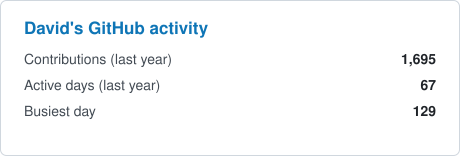

<h1 align="center">Hey there! I'm David</h1>

Cloud-native and business-oriented <strong>Lead Software Engineer</strong> with <strong>10+ years of experience</strong>, at <strong>TUI</strong> since 2021: first on the Product Experience team, then Platform Enablers, and since July 2026 leading engineering for <strong><a href="https://www.tuifly.com">tuifly.com</a></strong> within Airline Commercial · Digital Sales Solutions. AWS Certified Solutions Architect (Associate), with strong background in both AWS and Azure.

Passionate about building scalable, customer-facing products on .NET using cloud-native architectures, AI-augmented workflows, and Infrastructure as Code (Terraform, AWS CDK). I've had the pleasure of collaborating with teams across the globe (USA, Germany, Netherlands, UK, Poland, India...) and delivering for customers such as Acciona, BSH, Orange, Essity, BMW, Aliseda, Lufthansa and Otto, among others.

Previously at <strong>Deloitte</strong> and <strong>Boehringer Ingelheim</strong>.

Outside the day job, I run <strong>DLCMEDIA</strong> and <strong>FunTechFactory</strong>, and I like getting my hands dirty with AI: agents, LLM integrations and the tooling around them.

## 🧪 Side projects & explorations

Things I build and run outside the day job, mostly .NET and TypeScript on a self-hosted VPS:

<ul>
  <li>🏠 <a href="https://misfincas.com"><strong>MisFincas</strong></a>: portfolio manager for Spanish landlords that works out the real net yield of a rental after taxes, fees and deductions (.NET 10, Next.js, PostgreSQL)</li>
  <li>🥙 <a href="https://kebabscore.com"><strong>KebabScore</strong></a>: rate and discover the best kebabs in your city, and share your ratings with friends (.NET 10, React PWA, PostgreSQL)</li>
  <li>🧭 <a href="https://atlas.funtechfactory.com"><strong>Atlas</strong></a>: travel planner and trip log with profiles, following and shared trips (SvelteKit, SQLite, OIDC)</li>
  <li>🧠 <strong>Nexo</strong>: my personal agentic system, where scheduled AI agents check my own rules and bring me decisions to approve (MCP)</li>
</ul>

More at <a href="https://funtechfactory.com">FunTechFactory</a>.

## 💌 Where can we connect?

## 🛠️ My Tech Stack

### 🔧 Languages & Frameworks

  
  
  
  
  

### 🤖 AI & LLMs

  
  
  

### 🏬 Databases

  
  
  

### ☁️ Cloud

  
  

  

### 🏗️ Infrastructure as Code

  
  

### 💼 DevOps & Code Management

  
  
  
  

## 📊 GitHub Stats

Most of my work lives in private repositories, so these count private contributions too.

  
  

