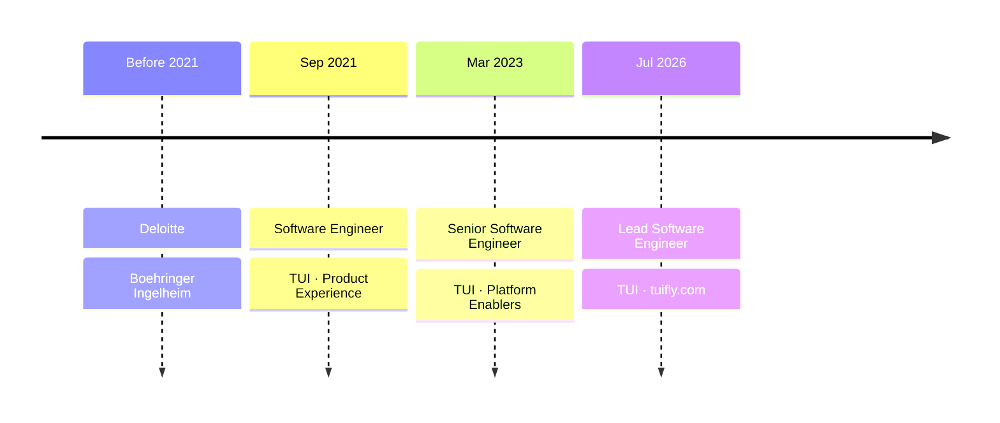
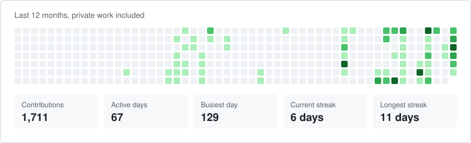

<h1 align="center">David López Cuadrado</h1>

  <strong>Lead Software Engineer · <a href="https://www.tuifly.com">tuifly.com</a> at TUI</strong> 
  .NET · AWS · Infrastructure as Code · AI · 10+ years

  
  
  

## About

Cloud-native and business-oriented engineer who likes building scalable, customer-facing products on .NET, with cloud-native architectures, Infrastructure as Code and AI-augmented workflows. Strong background in both AWS and Azure.

I've worked with teams across the USA, Germany, the Netherlands, the UK, Poland and India, delivering for customers such as Acciona, BSH, Orange, Essity, BMW, Aliseda, Lufthansa and Otto.

Outside the day job I run **DLCMEDIA** and **FunTechFactory**, and I like getting my hands dirty with AI: agents, LLM integrations and the tooling around them.

## Career

## Side projects

Things I build and run outside the day job, mostly .NET and TypeScript on a self-hosted VPS. More at [FunTechFactory](https://funtechfactory.com).

<table>
<tr>
<td width="50%" valign="top">

**🏠 [MisFincas](https://misfincas.com)** 
Portfolio manager for Spanish landlords that works out the real net yield of a rental after taxes, fees and deductions. 
.NET 10 · Next.js · PostgreSQL

</td>
<td width="50%" valign="top">

**🥙 [KebabScore](https://kebabscore.com)** 
Rate and discover the best kebabs in your city, and share your ratings with friends. 
.NET 10 · React PWA · PostgreSQL

</td>
</tr>
<tr>
<td width="50%" valign="top">

**🧭 [Atlas](https://atlas.funtechfactory.com)** 
Travel planner and trip log with profiles, following and shared trips. 
SvelteKit · SQLite · OIDC

</td>
<td width="50%" valign="top">

**🧠 Nexo** 
My personal agentic system, where scheduled AI agents check my own rules and bring me decisions to approve. 
AI agents · MCP · private

</td>
</tr>
</table>

## Stack

| Area | Tools |
|---|---|
| **Build** | C# · .NET 10 · TypeScript · Python · Angular |
| **Cloud** | AWS · Azure |
| **Infrastructure** | Terraform · AWS CDK · Docker |
| **Data** | PostgreSQL · SQL Server · DynamoDB |
| **AI** | LLMs · AI agents · MCP · Amazon Bedrock |
| **Delivery** | GitHub Actions · Azure DevOps · GitLab |

## Activity

<picture>
  <source media="(prefers-color-scheme: dark)" srcset="assets/activity-dark.svg">
  
</picture>
